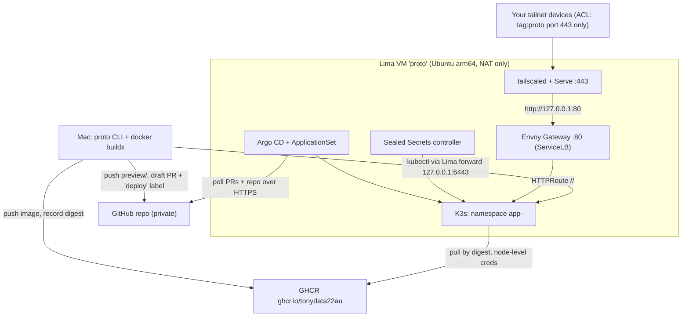

# Plan: personal GitOps platform (`tonypham-prototypes-deploy`)

Status: v3.1 (revised after Astra reviews #1–#3; final score 8/10, "ready after fixes", fixes applied) · Task: TPD-1 · Owner: Tony Pham (`tonydata22au`)

## 1. Goal

Deploy small personal prototypes with one command and remove them by closing a pull request:

> build app → `proto deploy` → preview PR opens/updates → Argo CD deploys it → open it privately over Tailscale → `proto destroy` closes the PR → app and namespace disappear.

- **GitHub** (`tonydata22au/tonypham-prototypes-deploy`, private) is the source of truth: platform config on `main`, per-app config on `preview/<app>` branches.
- **GHCR** (`ghcr.io/tonydata22au/*`) stores container images, referenced by digest.
- **This Mac** hosts the cluster: a Lima Linux VM running K3s, Argo CD, Helm (as Argo's renderer), Envoy Gateway, and Sealed Secrets.

No paid service is required. Two limits follow from that: private-repo Actions minutes are capped by the free allowance (local builds are the fallback), and merge-blocking on a private Free-plan repo is procedural rather than enforced (see §10).

### Decisions (confirmed with the user)

| Area | Decision |
|---|---|
| GitHub identity | `tonydata22au`; repo `tonydata22au/tonypham-prototypes-deploy` (private) |
| Images | `ghcr.io/tonydata22au/<app>`, `linux/arm64`, pinned by digest |
| Host | This Mac (Apple Silicon, 14 cores, 24 GB) → Lima VM running K3s |
| Access | Tailscale private HTTPS (Tailscale Serve) only; nothing public |
| CLI | Written fresh (no Holistics code): shell script first, Go later |
| Workloads | Stateless only in v1: static sites, HTTP APIs, background workers |
| Secrets | Sealed Secrets → Kubernetes Secrets (no 1Password) |

### Non-goals for v1

Public internet exposure, custom domains, persistent volumes or databases, multi-node or HA, auto-promotion of previews, running third-party PRs, custom 404 pages, exposing Argo CD over the network, and automated image garbage collection.

## 2. Architecture



Two separate flows:

- **Deploy (pull-based):** Argo CD polls GitHub. GitHub never needs inbound access to the Mac, so there are no webhooks and no public endpoint.
- **Traffic:** tailnet device → `https://proto.<tailnet>.ts.net/<app>/` → Tailscale Serve (TLS) → Envoy on the VM's `127.0.0.1:80` → `HTTPRoute` → app Service.

## 3. Key design choices (and why)

1. **One chart, not two.** A single `charts/app` chart with `mode: web | worker`. A "static app" is a web app whose image is a small static file server with the bundle baked in. The ApplicationSet always uses the same chart, so it never has to read per-app metadata.
2. **Stable namespace per app: `app-<name>`.** There is one preview branch per app, so the name is unique. Strict-scope sealed secrets bind to namespace + Secret name, so they stay valid across close/reopen and across new PRs for the same app.
3. **Everything platform-critical is derived from the branch name inside the trusted chart.** The namespace, path, Secret name, and Gateway reference are computed from `appName` (an Argo parameter taken from the branch). They are not read from app-supplied values (§9).
4. **Node-level GHCR credentials.** K3s `registries.yaml` holds one read-only GHCR token. No per-namespace pull secrets exist.
5. **Disposable cluster, precious keys.** Desired state lives in Git. Recovery is: rebuild the VM from scripts, restore the Sealed Secrets keys and the bootstrap tokens, and let Argo redeploy. There are no K3s datastore backups because there is no app data.
6. **Argo owns everything after one Helm install.** Bootstrap Helm-installs Argo CD only. Every other platform component, including Argo CD itself, is an Argo `Application` with the chart version pinned in Git (§7).
7. **Sealed Secrets key renewal disabled** (`keyrenewperiod: 0`). One long-lived key is backed up once, verified, and rotated manually (yearly, or on suspected compromise). This removes both the weekly-backup gap and the stale-certificate problem that automatic 30-day renewal creates.
8. **Label-gated, draft-only previews.** A PR deploys only if it is open, targets `main`, its head is `preview/<app>`, and it has the `deploy` label. The CLI opens previews as **draft** PRs, which GitHub refuses to merge.

## 4. Repository layout

```text
.
├── README.md
├── docs/
│   ├── PLAN.md                 # this file
│   ├── QUICKSTART.md
│   ├── APP-CONTRACT.md         # values schema, path contract, base-path build recipes
│   ├── SECRETS.md
│   └── OPERATIONS.md           # upgrades, rotation, recovery, troubleshooting
├── platform/
│   ├── versions.env            # pins consumed by scripts: LIMA, K3S, ARGOCD_CHART, GATEWAY_API
│   ├── lima/proto.yaml         # VM definition
│   ├── k3s/config.yaml
│   ├── argocd/
│   │   ├── bootstrap-values.yaml   # used once by `helm install argo-cd`, and by Argo's own Application
│   │   ├── root.yaml               # root Application → platform/apps (app-of-apps)
│   │   └── root-drill.yaml         # drill-only root → platform/overlays/drill (§14)
│   └── apps/                   # every platform Application; chart versions pinned *here*
│       ├── argocd.yaml               # wave 0: Argo CD manages itself (same release name + values)
│       ├── sealed-secrets.yaml       # wave 0
│       ├── gateway-crds.yaml         # wave 0: Envoy's gateway-crds-helm chart = sole owner of Gateway API + Envoy CRDs
│       ├── envoy-gateway.yaml        # wave 1
│       ├── gateway.yaml              # wave 2: GatewayClass, Gateway, gateway namespace (path platform/gateway/)
│       └── previews.yaml             # wave 3: AppProject + ApplicationSet (path platform/previews/)
├── platform/gateway/           # plain manifests
├── platform/previews/          # appproject.yaml, applicationset.yaml
├── platform/overlays/drill/    # kustomize overlay: label `drill`, hostname proto-drill
├── charts/app/                 # the one app chart + values.schema.json
├── examples/                   # static-base, hello-static, hello-api, hello-worker
├── scripts/
│   ├── vm-up                   # create/start Lima VM, register autostart
│   ├── bootstrap               # staged: cluster | keys | platform (idempotent)
│   ├── backup-keys / restore-keys
│   ├── validate                # offline: lint, render, schema, kubeconform
│   └── e2e                     # online: lifecycle + negative tests against the live cluster
├── cli/proto                   # shell CLI v1
└── .github/workflows/
    ├── validate.yml
    └── examples.yml
```

**Ownership map.** Each resource has exactly one owner:

| Resource | Owner |
|---|---|
| Lima VM, K3s, `registries.yaml`, tailscaled + Serve | `scripts/vm-up`, `scripts/bootstrap --stage cluster` |
| Sealed Secrets key Secret, Argo repo/PR Secrets | `scripts/bootstrap --stage keys` / `restore-keys` (never Git) |
| Argo CD | `helm install` once by bootstrap → adopted by `platform/apps/argocd.yaml` (same release name `argocd`, same namespace, same values file). Bootstrap never upgrades it again |
| Everything else in `platform/` | Argo, via `root.yaml` |
| `apps/<name>/*` | preview branch, rendered by the `previews` ApplicationSet |

Version pins live in exactly two places. `platform/versions.env` holds Lima, K3s, the Gateway API bundle, and the bootstrap Argo chart version (used by scripts). The `targetRevision` fields in `platform/apps/*.yaml` hold the in-cluster charts. The Argo chart version must match in both, and `scripts/validate` checks this. Upgrading means a commit to `main`; `bootstrap` is never re-run for it.

On a preview branch, the only added files are:

```text
apps/<name>/
├── values.yaml            # required
└── secrets.sealed.yaml    # always present; `encryptedData: {}` when the app has no secrets
```

## 5. Phase 0: accounts and prerequisites

- [ ] **Tokens.** Each has a 90-day expiry and a calendar reminder. They are stored in the macOS Keychain and are also included in the encrypted key bundle (§11).
  - `ARGOCD_GITHUB_TOKEN`: fine-grained PAT, this repo only, with **Contents: read, Pull requests: read, Metadata: read**. It is used for two Argo Secrets: the repository credential and `argocd-github-pr` (for the PR generator).
  - `GHCR_PULL_TOKEN`: classic PAT with `read:packages` only (GHCR packages don't support fine-grained PATs). It goes into K3s `registries.yaml`.
  - Push: `gh auth refresh -s write:packages`, then `gh auth token | docker login ghcr.io -u tonydata22au --password-stdin`.
- [ ] **Tailscale** (free Personal plan). Enable MagicDNS and HTTPS certificates. Then:
  - Create the tag `tag:proto`.
  - Add an ACL/grant allowing only your own devices to reach `tag:proto:443`. Ports 80, 6443, NodePorts, and SSH are not allowed.
  - Create a pre-approved, tagged auth key for unattended (re)registration. It is also kept in the key bundle.
- [ ] **Local tools** (Homebrew): `lima` (pinned in `versions.env`), `kubectl`, `helm`, `kubeseal`, `argocd`, `age`, `gh`, `yq`, `jq`, `kubeconform`, `crane`. Docker Desktop is already installed and builds the images.
- [ ] **Power:** keep the Mac on mains power with system sleep disabled while plugged in (`sudo pmset -c sleep 0`). The availability promise is stated in §6.
- [ ] **Backup targets:** an iCloud Drive folder **and** an external drive. Both hold only age-encrypted bundles. The age private key is kept in your password manager and also on paper.

**Done when** the tokens exist with minimal scopes, the Tailscale ACL is saved, and the tools are installed at their pinned versions.

## 6. Phase 1: VM, K3s, network boundary

1. `platform/lima/proto.yaml`:
   - Ubuntu 24.04 arm64, `vmType: vz`, 4 vCPU / 8 GiB / 60 GiB. These are starting values, to tune by observation.
   - **No host mounts** (`mounts: []`).
   - **Default user-mode NAT networking only.** No `vzNAT`, no socket_vmnet, no bridged interface, so the VM is not on your LAN.
   - **Explicit `portForwards`:** forward guest `6443` → host `127.0.0.1:6443` only, then a final rule `ignore: true` for every other guest port. Lima's default would otherwise auto-forward any listening port to the Mac.
2. `scripts/vm-up` creates and starts the instance `proto` with the pinned Lima version, then registers autostart (`limactl start-at-login proto`, per [Lima autostart](https://lima-vm.io/docs/usage/autostart/)).
3. `scripts/bootstrap --stage cluster` runs inside the VM and is idempotent:
   - Writes `/etc/rancher/k3s/registries.yaml` (root-owned, mode 0600) with the GHCR token read from stdin. This happens **before** K3s is installed, so no restart is needed. On later token rotation, the script rewrites the file and restarts `k3s`.
   - Installs the pinned K3s with `config.yaml` containing:
     - `disable: [traefik]`
     - `secrets-encryption: true`
     - `write-kubeconfig-mode: "0600"`
     - `tls-san: [127.0.0.1]`
     - The built-in network policy controller left enabled.
     - ServiceLB kept enabled.
   - Installs `tailscaled` from Tailscale's apt repo, enables the systemd unit, and runs `tailscale up --auth-key=<from stdin> --hostname=proto --advertise-tags=tag:proto`.
   - Guest firewall (`nftables`): drop inbound on `tailscale0` except Serve's 443. This is a second layer on top of the tailnet ACL. Verify at M2 that Serve still works with it on, since Serve is handled inside `tailscaled`. If Serve breaks, rely on the ACL and document that.
4. Copy the kubeconfig to the Mac as context `proto`, with server `https://127.0.0.1:6443`.

**Availability promise:** after a Mac reboot **and your login** (FileVault requires a login anyway), the VM autostarts, and K3s, the platform, and Serve come back with no manual steps. While the Mac is asleep or off, apps are down. That is accepted for prototypes.

**Done when (all measured, not assumed):**

- The node is Ready.
- A test pod pulls a private GHCR image by digest.
- After a Mac reboot and login, everything returns.
- From another LAN device, the Mac exposes nothing new.
- From a tailnet device, only `https://proto.<tailnet>.ts.net` answers; `:80`, `:6443`, and NodePorts on the tailnet IP do not.

## 7. Phase 2: platform via Argo CD (app-of-apps)

`scripts/bootstrap --stage keys` runs **before** any controller that uses the keys exists:

- **Fresh install:** creates the Argo repo Secret and the `argocd-github-pr` Secret from stdin, in namespace `argocd`.
- **Recovery:** additionally restores the Sealed Secrets key Secret(s) into `kube-system`, keeping their `sealedsecrets.bitnami.com/sealed-secrets-key` label (§14).

`scripts/bootstrap --stage platform`:

1. `helm install argocd argo/argo-cd --version $ARGOCD_CHART -n argocd -f platform/argocd/bootstrap-values.yaml`. This is a non-HA install with Dex disabled and the ApplicationSet controller enabled. The values include the `resource.customizations.health.argoproj.io_Application` health check, so the app-of-apps sync waves really wait for each child Application to be Healthy (Argo removed this check by default). Without it, wave order would only order *creation*.
2. `kubectl apply -f platform/argocd/root.yaml`. Argo then syncs `platform/apps/*` in waves:
   - **Wave 0:**
     - Argo CD adopts itself, with the same release name and values, so no diff.
     - Sealed Secrets (`fullnameOverride: sealed-secrets-controller`, `keyrenewperiod: "0"`).
     - CRDs from Envoy's `gateway-crds-helm` chart (same version as Envoy Gateway). This is the **single owner** of both the Gateway API standard CRDs and the Envoy extension CRDs.
   - **Wave 1:** Envoy Gateway (`gateway-helm` with `helm.skipCrds: true`, so no second copy of the CRDs is rendered). It uses the default deployment mode, so the Envoy proxy pods run in `envoy-gateway-system`, not in `gateway`.
   - **Wave 2:** `gateway` namespace, `GatewayClass eg`, `Gateway proto` (HTTP listener :80, `allowedRoutes` selecting namespaces with label `proto.dev/preview=true`). The Envoy Service is type LoadBalancer, which ServiceLB binds to VM port 80.
   - **Wave 3:** `AppProject previews` + `ApplicationSet previews`.
3. **Fresh install only:** wait for the Sealed Secrets controller to generate its key, then immediately run `scripts/backup-keys`. The script exports the key, age-encrypts it, writes to both targets, decrypts one copy, and compares fingerprints. Bootstrap **fails** if verification fails, and the CLI refuses to seal until a verified backup exists (`~/.config/proto/key-backup.ok` holds the key fingerprint).

Unmatched paths get Envoy's default 404. Argo CD UI/CLI access is through `kubectl port-forward` only.

**Done when** every platform Application is Synced/Healthy, a values change on `main` is reconciled, and `helm` shows no drift between the bootstrap install and the Argo-managed Argo CD.

## 8. Phase 3: private HTTPS and the path contract

Inside the VM (also scripted in `bootstrap --stage cluster`):

```sh
tailscale serve --bg --https=443 http://127.0.0.1:80
```

Each app gets these two HTTPRoute rules (rendered by the chart):

| Rule | Match | Filters |
|---|---|---|
| redirect | `Exact` `/<app>` | `RequestRedirect`: path `ReplaceFullPath: /<app>/`, `scheme: https`, `port: 443`, `statusCode: 301` |
| route | `PathPrefix` `/<app>/` | `URLRewrite` with `path.type: ReplacePrefixMatch, replacePrefixMatch: /` (omitted when `route.stripPrefix: false`) **and** `RequestHeaderModifier` **set** `X-Forwarded-Prefix: /<app>`, `X-Forwarded-Proto: https`, `X-Forwarded-Host: proto.<tailnet>.ts.net` |

Using `set` (rather than `add`) overwrites any client-supplied spoofed values. Redirect and rewrite live in separate rules because Gateway API forbids combining them.

**App obligations** (documented in `docs/APP-CONTRACT.md`):

- `proto deploy ./dist` takes a bundle **already built for `/<app>/`**. Example: `vite build --base=/hello/`, then `proto deploy ./dist --name hello --spa`.
  - The CLI fails if `index.html` references root-absolute assets (`src="/assets/...`) outside `/<app>/`.
  - Relative asset paths are discouraged for SPAs, because they break on nested-route refresh.
- SPA history fallback comes from the static server image (unknown paths serve `index.html`).
- APIs that issue redirects or absolute URLs must honour `X-Forwarded-Prefix`/`-Proto`/`-Host`. The doc includes framework snippets (Express `trust proxy`, FastAPI `root_path`).
- All apps share one origin, so cookies and storage are shared. This is acceptable for your own trusted apps; per-app hostnames are v2.

**Done when** tests pass for:

- `/hello` → 301 `/hello/`.
- `/hello/`, nested path + query string, and POST to an API.
- Backend-issued redirects.
- A spoofed `X-Forwarded-Prefix` is overwritten.
- Two apps work at the same time.
- A deep-link refresh loads assets.

## 9. Phase 4: the app chart (`charts/app`)

**Trusted inputs** come from ApplicationSet `helm.parameters`, which take precedence over value files: `appName` and `prNumber`. Everything platform-critical is **computed in templates** from `appName`:

- namespace `app-{{appName}}`
- path `/{{appName}}/`
- Secret name `{{appName}}-secrets`
- Gateway ref `gateway/proto` (hard-coded)
- labels

None of these exist as values keys. The schema sets `additionalProperties: false` at every level, so a preview branch cannot inject them. The chart never calls `tpl` on app-supplied strings and has no "extra manifests" escape hatch.

**App-supplied `values.yaml`** (validated by `values.schema.json`; `image`, `mode` required, no usable defaults):

```yaml
mode: web                 # web | worker   (required)
image:                    # required; digest required, tag informational
  repository: ghcr.io/tonydata22au/hello-api
  digest: sha256:3f1c...
  tag: sha-abc1234
port: 8080
route: { stripPrefix: true }
healthcheck: { path: /healthz }   # web: omit → TCP probe on `port`. worker: no probes unless `healthcheck.exec` is given
env: { LOG_LEVEL: info }
secretEnv: [API_KEY]
replicas: 1               # 0 = paused, max 2
resources:                # schema caps: requests ≤ 250m/256Mi, limits ≤ 1 CPU/512Mi
  requests: { cpu: 25m, memory: 32Mi }
  limits:   { memory: 256Mi }
```

**Rendered resources** (the whole allowlist; nothing else is possible):

- `Namespace app-<name>` (sync-wave −2, so it exists before the wave −1 SealedSecret), labelled with:
  - `proto.dev/preview=true`
  - Pod Security `pod-security.kubernetes.io/enforce: restricted`

  The chart owns the namespace, so the cascading finalizer deletes it (Argo's `CreateNamespace=true` would not).
- `Deployment`:
  - non-root, read-only root filesystem + `emptyDir` `/tmp` with a size limit
  - all capabilities dropped, `seccompProfile: RuntimeDefault`
  - `automountServiceAccountToken: false`
  - `enableServiceLinks: false`
- `Service` + `HTTPRoute` (web only).
- `SealedSecret <name>-secrets` (sync-wave −1) when `encryptedData` is non-empty.
- `ResourceQuota` (cpu 1, memory 768Mi, ephemeral-storage 2Gi, pods 4, services 1) + `LimitRange` defaults.
- `NetworkPolicy`: default-deny ingress; allow ingress to the app port only from pods in `envoy-gateway-system` (matched by `kubernetes.io/metadata.name` + the Envoy proxy pod labels, verified at M2). Egress stays open (prototypes call external APIs). This restricts *direct* pod-to-pod ingress only. An app can still reach another app through the shared gateway URL, which is acceptable for trusted personal apps.

**Secret rotation ordering:**

1. The SealedSecret is sync-wave −1, and the Deployment is wave 0.
2. Argo's built-in SealedSecret health check reports Healthy only once the controller has unsealed the current generation. The plan must verify this against the pinned Argo version and add a `resource.customizations.health` override if it does not.
3. Argo will therefore not apply the Deployment until the Secret is updated. The Deployment carries a `checksum/secrets` annotation of the ciphertext, which triggers the rollout.
4. The test is that `e2e` delays the controller (scale it to 0), rotates a secret, scales the controller back up, and asserts that the pod sees the new value.

**Supported app count:** about 10 concurrent apps within the VM budget. `proto deploy` warns past 10.

**Done when** `scripts/validate` passes:

- `helm lint`
- `helm template` of every example
- `kubeconform` against the pinned CRD schemas
- negative fixtures: unknown keys, missing digest, a PVC attempt, privileged pods, and oversized resources are all rejected

and `scripts/e2e` shows the static base image and examples running under `restricted` PSA.

## 10. Phase 5: PR-driven ApplicationSet

`platform/previews/applicationset.yaml`:

```yaml
apiVersion: argoproj.io/v1alpha1
kind: ApplicationSet
metadata: { name: previews, namespace: argocd }
spec:
  goTemplate: true
  goTemplateOptions: ["missingkey=error"]
  generators:
    - pullRequest:
        requeueAfterSeconds: 60
        github:
          owner: tonydata22au
          repo: tonypham-prototypes-deploy
          tokenRef: { secretName: argocd-github-pr, key: token }
          labels: [deploy]
        filters:                      # one entry = AND of its conditions
          - branchMatch: "^preview/[a-z][-a-z0-9]{0,22}[a-z0-9]$"
            targetBranchMatch: "^main$"
  template:
    metadata:
      name: 'app-{{ trimPrefix "preview/" .branch }}'
      finalizers: [resources-finalizer.argocd.argoproj.io]
    spec:
      project: previews
      destination:
        server: https://kubernetes.default.svc
        namespace: 'app-{{ trimPrefix "preview/" .branch }}'
      sources:
        - repoURL: https://github.com/tonydata22au/tonypham-prototypes-deploy.git
          targetRevision: main                       # trusted chart
          path: charts/app
          helm:
            valueFiles:
              - '$values/apps/{{ trimPrefix "preview/" .branch }}/values.yaml'
              - '$values/apps/{{ trimPrefix "preview/" .branch }}/secrets.sealed.yaml'
            # ignoreMissingValueFiles stays false: missing config fails closed
            parameters:
              - { name: appName,  value: '{{ trimPrefix "preview/" .branch }}' }
              - { name: prNumber, value: '{{ .number }}' }
        - repoURL: https://github.com/tonydata22au/tonypham-prototypes-deploy.git
          targetRevision: '{{ .head_sha }}'          # exact PR commit
          ref: values
      syncPolicy:
        automated: { prune: true, selfHeal: true }
        syncOptions: [ServerSideApply=true]
```

**`AppProject previews`:**

- Source: this repo only. Destination: in-cluster, namespaces `app-*`.
- `clusterResourceWhitelist`: `{group: "", kind: Namespace}`.
- `namespaceResourceWhitelist`:
  - `apps/Deployment`
  - core `Service`, `ResourceQuota`, `LimitRange`
  - `gateway.networking.k8s.io/HTTPRoute`
  - `bitnami.com/SealedSecret`
  - `networking.k8s.io/NetworkPolicy`
- Plain `Secret`s are not allowed; only the controller creates those.
- If the pinned Argo version supports name-restricted cluster resources, restrict `Namespace` to `app-*`. If not, the chart-computed namespace plus the schema are the guard, and `e2e` tests an override attempt.

**Lifecycle contract** (each row is an `e2e` test):

| Action | Result |
|---|---|
| Draft PR `preview/hello` → `main` + label `deploy` | `app-hello` created; `/hello/` works |
| Push a commit with a new digest | Same app, rolling update |
| `replicas: 0` (`proto pause`) | Pods gone. Route still attached, so Envoy returns 503 |
| Remove label, or close PR (`proto destroy`) | Application cascade-deletes the app **and** namespace. The CLI waits until the namespace is gone, and reports stuck finalizers with diagnostics (never force-removes them) |
| Re-add label / reopen PR / `proto deploy` again | Recreated from the **retained branch**; sealed secrets still decrypt |
| `proto destroy --purge` | Also deletes the branch. **Irreversible**: config and ciphertext are gone, and secrets must be set again |
| Labelled PR with a non-`preview/*` head, or a `preview/*` PR targeting another branch | Ignored (negative tests) |
| Missing `values.yaml` on the branch | Argo sync error, no Application resources (fail closed) |
| Bad digest / crash loop | Argo Degraded; `proto status` shows the pod reason + last events |

**Merge prevention (honest version):** draft PRs cannot be merged without first being marked ready, and the CLI only creates drafts. `validate.yml` also fails a `no-preview-merge` job whenever the head is `preview/*`. Making that check *required* needs branch protection, which GitHub only offers for private repos on paid plans. On the Free plan this is a safeguard you follow by hand, not an enforced block. Merging a preview by accident only adds files under `apps/` on `main`, which no Application reads.

**Done when** the whole table passes in `scripts/e2e` for `hello-static` and `hello-api`.

## 11. Phase 6: secrets

**Flow:**

1. A hidden prompt (or stdin) collects the value.
2. `kubeseal --scope strict --namespace app-<name> --name <name>-secrets` seals it with the cert at `~/.config/proto/sealed-secrets.pem`.
3. The ciphertext is merged into `apps/<name>/secrets.sealed.yaml`.
4. The CLI commits and pushes to the preview branch.
5. The controller unseals it (wave −1), the Deployment rolls out (wave 0), and the pod reads it via `secretEnv`.

**Certificate handling:** `proto` fetches the cert with `kubeseal --fetch-cert --controller-name sealed-secrets-controller --controller-namespace kube-system`. It stores the cert's SHA-256 fingerprint and, before every seal, compares it against the live cert and against `key-backup.ok`. A mismatch refuses to seal until `backup-keys` has run.

**Key bundle** (`scripts/backup-keys`, age-encrypted, two targets, verified by test-decrypting):

- Sealed Secrets key Secret(s)
- `ARGOCD_GITHUB_TOKEN`, `GHCR_PULL_TOKEN`
- Tailscale auth key
- `versions.env` snapshot

**Manual key rotation** (yearly or on compromise):

1. Generate a new key (the controller supports a manual renewal trigger).
2. Back it up and verify it.
3. Reseal all apps (`proto secret reseal --all`).
4. Keep the old key until no branch references ciphertext made with it.

**Rules:**

- Values never go in argv, logs, or shell history.
- Keys never go in Git.
- GitHub Actions secrets are for CI only.

**Done when:**

- `hello-api` reads `API_KEY`.
- The value appears nowhere in Git, the image, logs, or `argocd app manifests`.
- A ciphertext copied to another namespace or name fails to unseal.
- The delayed-controller rotation test passes.

## 12. Phase 7: `proto` CLI (shell v1)

Config lives in `~/.config/proto/config.yaml`: owner/repo, registry prefix, tailnet hostname, kube context.

| Command | Does |
|---|---|
| `proto deploy ./dist --name hello [--spa]` | Checks the asset base path → builds FROM the static base for `linux/arm64` → pushes → resolves the digest with `crane digest` → writes `values.yaml` (digest + tag) on `preview/hello` → pushes → opens/updates a **draft** PR labelled `deploy` |
| `proto deploy --image ghcr.io/tonydata22au/hello-api:v1 --name hello-api [--port 8080] [--worker]` | Resolves the tag to a digest first, then the same flow |
| `proto secret set <name> <KEY>` / `proto secret reseal --all` | §11 |
| `proto status <name>` | PR state → Argo sync/health → pod status/events → HTTPS check of the URL |
| `proto logs <name> [-f]` | `kubectl logs` in `app-<name>` |
| `proto pause/resume <name>` | Commits `replicas: 0/1` |
| `proto destroy <name> [--purge]` | Closes the PR and waits for namespace deletion. `--purge` also deletes the branch |
| `proto list` | Preview PRs (open + closed-but-retained) with URL and health |
| `proto doctor` | VM up, node Ready, Argo apps healthy, Argo repo connection OK, Serve active, disk free, cert fingerprint == backed-up fingerprint, token expiry dates |

**Implementation:**

- The CLI works in a `git worktree` under a cache directory and never touches your current checkout.
- It authenticates through `gh`.
- Names must match `^[a-z][-a-z0-9]{0,22}[a-z0-9]$`, which keeps `app-<name>` and derived resource names well under limits.
- Reserved names: `argocd`, `gateway`, `kube-*`, `default`.
- Port to Go once the commands have settled.

**Done when** a static site and a prebuilt API can be deployed, updated, paused, destroyed, and redeployed using only `proto`.

## 13. Phase 8: CI

`validate.yml` (`permissions: contents: read`) runs on PRs to `main` and pushes to `preview/*`:

- `scripts/validate` for the chart and examples.
- For preview branches, it also checks:
  - Exactly one `apps/<name>/` directory exists, and it matches the branch.
  - The values pass the schema.
  - `secrets.sealed.yaml` contains only `encryptedData`.
- The `no-preview-merge` job.

`examples.yml` (`permissions: contents: read, packages: write`) builds the example and static-base images for `linux/arm64` on pushes to `main`, using `GITHUB_TOKEN`.

**Rules:**

- No cluster credentials in Actions, ever.
- CI does **not** gate Argo. Argo acts on PR state and the label, and the docs say so.
- Actions spending limit is $0. Your own apps are built locally.

## 14. Phase 9: operations and recovery

`docs/OPERATIONS.md` covers:

- **Health:** `proto doctor`.
- **Upgrades:** edit `platform/apps/*.yaml` versions and commit to `main`. For K3s and Lima, bump `versions.env` and re-run `bootstrap --stage cluster` (in-place K3s upgrade).
- **Rollback:** revert the digest commit on the preview branch.
- **Rotation:** PATs every 90 days. GHCR rotation means rewriting `registries.yaml` and restarting `k3s`; the Argo token is rotated by updating both Secrets. **Every rotation ends with `backup-keys`**, so the bundle never holds a dead token. `doctor` warns when the bundle is older than the newest token.
- **Image retention (manual in v1):** GHCR storage is free, so there is no automated GC. The doc explains how to list the digests referenced by preview branches (`git grep digest` across `preview/*`) and delete unreferenced versions by hand via `gh api`. Automate this only if storage becomes a problem.

**What recovery needs** (the key bundle is necessary but not sufficient):

- The age identity, from your password manager or paper.
- GitHub access, to issue new PATs if the bundled ones have expired.
- Tailscale admin access, to create a **fresh** auth key. Bundled auth keys expire within 90 days, so always plan to generate a new one.
- The repo itself.

**Real recovery** (the original VM is lost):

1. Decrypt the bundle and check the key fingerprint against `key-backup.ok`.
2. Remove the stale `proto` node in the Tailscale admin console, so the hostname is reclaimed rather than becoming `proto-1`.
3. Run `vm-up`, then `bootstrap --stage cluster`, using a fresh auth key.
4. Run `bootstrap --stage keys --restore` (tokens + Sealed Secrets key) **before** any controller exists.
5. Run `bootstrap --stage platform`. Sealed Secrets starts with the restored key, and the open previews redeploy.
6. Verify `doctor`, `tailscale serve status`, the hostname, and that `hello-api` reads its secret.

**Drill** (run once at M6; never touches the live `proto`):

- `scripts/vm-up --instance proto-drill --api-port 16443` creates a separate Lima instance with a different host port and kube context `proto-drill`.
- The Tailscale hostname is `proto-drill`, and the gateway hostname config is parameterised accordingly.
- `bootstrap --drill` applies `root-drill.yaml` instead of `root.yaml` **before the first sync**. Its source is the declarative kustomize overlay `platform/overlays/drill`, which sets the ApplicationSet label `drill` and the hostname `proto-drill`, so self-heal keeps the drill isolated instead of reverting it. The drill checklist asserts that after several reconcile cycles no `deploy`-labelled app exists. Only a dedicated test PR (`preview/drillhello`, labelled `drill`, using a test secret) is deployed, so live apps and real credentials are never duplicated.
- Run steps 1 and 3–6 above against it, record the measured duration, then delete the drill VM and its tailnet node.

## 15. Milestones

| # | Deliverable | Proves |
|---|---|---|
| M1 | Repo skeleton, `versions.env`, Lima VM + K3s, private GHCR pull, network boundary tests | Host is viable and closed |
| M2 | Tailscale Serve + Envoy Gateway + one hand-applied app with the full path-contract tests | Traffic path |
| M3 | Argo app-of-apps (incl. self-managed Argo), Sealed Secrets + verified key backup, `charts/app` + `scripts/validate` | GitOps platform + chart safety |
| M4 | Preview ApplicationSet + `scripts/e2e` lifecycle and negative tests (static + API with secret) | Core workflow |
| M5 | `proto` shell CLI incl. `doctor` | Convenience |
| M6 | CI workflows, OPERATIONS.md, isolated recovery drill in `proto-drill` | Durability |

**First milestone worth showing:** the end of M4, where a static app and a secret-using API are created and removed purely by opening and closing PRs.

## 16. Acceptance tests (v1 done)

- [ ] A static SPA deploys via a labelled draft PR, and a deep-link refresh loads its assets.
- [ ] An API receives its sealed secret. A worker runs with no Service or route.
- [ ] A private GHCR image pulls by digest with no per-namespace pull secret.
- [ ] The path contract tests pass (§8). Two apps work at the same time, and an unknown path gets a 404.
- [ ] A new digest rolls out. A broken image is reported clearly by `proto status`.
- [ ] Close deletes the app and namespace. Reopen/redeploy restores it, including the secret. `--purge` is documented as irreversible.
- [ ] Negative tests:
  - [ ] Override attempts on namespace/path/gateway are rejected.
  - [ ] Disallowed kinds and PVCs are rejected.
  - [ ] PRs with a mismatched branch or target are ignored.
  - [ ] A missing `values.yaml` fails closed.
  - [ ] Ciphertext moved to another namespace fails to unseal.
- [ ] Secret rotation with a delayed controller ends with the new value in the pod.
- [ ] After a Mac reboot and login, everything returns with no manual steps.
- [ ] From the LAN and from the tailnet, only Serve's HTTPS on `proto` is reachable. A device outside the tailnet reaches nothing.
- [ ] The isolated recovery drill in `proto-drill` succeeds from the key bundle plus the listed prerequisites, without affecting live `proto`.
- [ ] No dependency on Holistics domains, accounts, OAuth apps, Blacksmith, or 1Password.

## 17. Risks

| Risk | Mitigation |
|---|---|
| Mac sleeps or reboots | Accepted; autostart after login; `proto doctor` |
| VM pressure on a dev laptop | Fixed VM size, per-namespace quotas, schema resource caps, ~10-app soft cap, `replicas: 0` |
| arm64-only images | `--platform linux/arm64`. A future x86 host needs multi-arch builds |
| PAT expiry silently breaks Argo or pulls | 90-day reminders; `doctor` shows expiry dates and Argo repo status |
| Losing the Sealed Secrets key | Renewal disabled; verified backup in two places; CLI refuses to seal without one; drill |
| Merging a preview | Draft-only PRs + failing check; harmless if it happens anyway |
| Shared origin across apps | Documented; trusted apps only; per-app hostnames in v2 |
| Laptop also used for work | NAT-only VM, no host mounts, personal accounts/tokens only |
| Unverified assumptions (Argo SealedSecret health semantics, name-restricted Namespace whitelisting, nftables vs Serve, Envoy proxy pod labels) | Each is verified at the milestone that introduces it, with a fallback already named in this plan |

Later (v2+): per-app hostnames, optional public sharing with auth, Postgres with backups, Go CLI, moving to a dedicated Linux box (same scripts without Lima).
