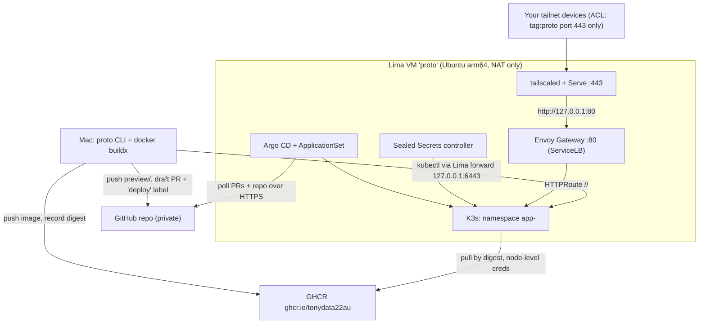

# Plan: personal GitOps platform (`tonypham-prototypes-deploy`)

Status: v5.2, **100/100** on the Astra rubric (`docs/reviews/astra-review-4-rubric.md`). Score history: v3.1 = 74, v4 = 84, v4.1 = 87–88, v5 = 94, v5.1 = 99, v5.2 = 100. The score rates the plan, not deployment: every milestone gate still has to pass at implementation time. Action items A1–A12 (review #4) and B1–B5 (review #5) are applied. Rubric: `docs/reviews/astra-review-4-rubric.md` · Task: TPD-1 · Owner: Tony Pham (`tonydata22au`)

## 1. Goal

Deploy small personal prototypes with one command and remove them by closing a pull request:

> build app → `proto deploy` → preview PR opens/updates → Argo CD deploys it → open it privately over Tailscale → `proto destroy` closes the PR → app and namespace disappear.

- **GitHub** (`tonydata22au/tonypham-prototypes-deploy`, private) is the source of truth: platform config on `main`, per-app config on `preview/<app>` branches.
- **GHCR** (`ghcr.io/tonydata22au/*`) stores container images, referenced by digest.
- **This Mac** hosts the cluster: a Lima Linux VM running K3s, Argo CD, Helm (as Argo's renderer), Envoy Gateway, and Sealed Secrets.

No paid service is required. Two limits follow from that: private-repo Actions minutes are capped by the free allowance (local builds are the fallback), and merge-blocking on a private Free-plan repo is procedural rather than enforced (see §10).

### Decisions (confirmed with the user)

| Area | Decision |
|---|---|
| GitHub identity | `tonydata22au`; repo `tonydata22au/tonypham-prototypes-deploy` (private) |
| Images | `ghcr.io/tonydata22au/<app>`, `linux/arm64`, pinned by digest |
| Host | This Mac (Apple Silicon, 14 cores, 24 GB) → Lima VM running K3s |
| Access | Tailscale private HTTPS (Tailscale Serve) only; nothing public |
| CLI | Written fresh (no Holistics code): shell script first, Go later |
| Workloads | Stateless only in v1: static sites, HTTP APIs, background workers |
| Secrets | Sealed Secrets → Kubernetes Secrets (no 1Password) |

### Non-goals for v1

Public internet exposure, custom domains, persistent volumes or databases, multi-node or HA, auto-promotion of previews, running third-party PRs, custom 404 pages, exposing Argo CD over the network, and automated image garbage collection.

## 2. Architecture



Two separate flows:

- **Deploy (pull-based):** Argo CD polls GitHub. GitHub never needs inbound access to the Mac, so there are no webhooks and no public endpoint.
- **Traffic:** tailnet device → `https://proto.<tailnet>.ts.net/<app>/` → Tailscale Serve (TLS) → Envoy on the VM's `127.0.0.1:80` → `HTTPRoute` → app Service.

## 3. Key design choices (and why)

1. **One chart, not two.** A single `charts/app` chart with `mode: web | worker`. A "static app" is a web app whose image is a small static file server with the bundle baked in. The ApplicationSet always uses the same chart, so it never has to read per-app metadata.
2. **Stable namespace per app: `app-<name>`.** There is one preview branch per app, so the name is unique. Strict-scope sealed secrets bind to namespace + Secret name, so they stay valid across close/reopen and across new PRs for the same app.
3. **Everything platform-critical is derived from the branch name inside the trusted chart.** The namespace, path, Secret name, and Gateway reference are computed from `appName` (an Argo parameter taken from the branch). They are not read from app-supplied values (§9).
4. **Node-level GHCR credentials.** K3s `registries.yaml` holds one read-only GHCR token. No per-namespace pull secrets exist.
5. **Disposable cluster, precious keys.** Desired state lives in Git. Recovery is: rebuild the VM from scripts, restore the Sealed Secrets keys and the bootstrap tokens, and let Argo redeploy. There are no K3s datastore backups because there is no app data.
6. **Argo owns everything after one Helm install.** Bootstrap Helm-installs Argo CD only. Every other platform component, including Argo CD itself, is an Argo `Application` with the chart version pinned in Git (§7).
7. **Sealed Secrets key renewal disabled** (`keyrenewperiod: 0`). One long-lived key is backed up once, verified, and rotated manually (yearly, or on suspected compromise). This removes both the weekly-backup gap and the stale-certificate problem that automatic 30-day renewal creates.
8. **Label-gated, CLI-created draft previews.** A PR deploys only if it is open, targets `main`, its head is `preview/<app>`, and it has the `deploy` label. The CLI opens previews as **drafts**, which GitHub won't merge until they are marked ready. Draft state is a convention, not enforced (§10).

## 4. Repository layout

```text
.
├── README.md
├── docs/
│   ├── PLAN.md                 # this file
│   ├── QUICKSTART.md
│   ├── APP-CONTRACT.md         # values schema, path contract, base-path build recipes
│   ├── SECRETS.md
│   └── OPERATIONS.md           # upgrades, rotation, recovery, troubleshooting
├── platform/
│   ├── versions.env            # LIMA=v2.2.1 K3S=v1.36.5+k3s1 ARGOCD_CHART=10.11.6 GATEWAY_API=v1.6.1 TAILSCALE=1.104.4 (§4.1)
│   ├── lima/proto.yaml         # VM definition
│   ├── k3s/config.yaml
│   ├── argocd/
│   │   ├── bootstrap-values.yaml   # used once by `helm install argo-cd`, and by Argo's own Application
│   │   ├── root.yaml               # root Application → platform/apps (app-of-apps)
│   │   └── root-drill.yaml         # drill-only root → platform/overlays/drill (§14)
│   └── apps/                   # every platform Application; chart versions pinned *here*
│       ├── argocd.yaml               # wave 0: Argo CD manages itself (same release name + values)
│       ├── sealed-secrets.yaml       # wave 0
│       ├── gateway-crds.yaml         # wave 0: Envoy's gateway-crds-helm chart = sole owner of Gateway API + Envoy CRDs
│       ├── envoy-gateway.yaml        # wave 1
│       ├── gateway.yaml              # wave 2: GatewayClass, Gateway, gateway namespace (path platform/gateway/)
│       └── previews.yaml             # wave 3: AppProject + ApplicationSet (path platform/previews/)
├── platform/gateway/           # plain manifests
├── platform/previews/          # appproject.yaml, applicationset.yaml
├── platform/overlays/drill/    # kustomize overlay: label `drill`, hostname proto-drill
├── charts/app/                 # the one app chart + values.schema.json
├── examples/                   # static-base, hello-static, hello-api, hello-worker
├── scripts/
│   ├── vm-up                   # create/start Lima VM, register autostart
│   ├── bootstrap               # staged: cluster | keys | platform (state machine, §7)
│   ├── backup-keys / restore-keys
│   ├── validate                # offline: lint, render, schema, kubeconform
│   ├── check-previews          # render chart on working tree against every retained preview (§13)
│   └── e2e                     # online: lifecycle + negative tests against the live cluster
├── cli/proto                   # shell CLI v1
└── .github/workflows/
    ├── validate.yml
    └── examples.yml
```

**Ownership map.** Each resource has exactly one owner:

| Resource | Owner |
|---|---|
| Lima VM, K3s, `registries.yaml`, tailscaled + Serve | `scripts/vm-up`, `scripts/bootstrap --stage cluster` |
| Sealed Secrets key Secret, Argo repo/PR Secrets | `scripts/bootstrap --stage keys` / `restore-keys` (never Git) |
| Argo CD | `helm install` once by bootstrap → adopted by `platform/apps/argocd.yaml` (same release name `argocd`, same namespace, same values file). Bootstrap never upgrades it again |
| Everything else in `platform/` | Argo, via `root.yaml` |
| `apps/<name>/*` | preview branch, rendered by the `previews` ApplicationSet |

Version pins live in exactly two places. `platform/versions.env` holds Lima, K3s, and the *initial* Argo chart version (used by scripts only). The `targetRevision` fields in `platform/apps/*.yaml` hold every in-cluster chart. `GATEWAY_API` is a compatibility **assertion**, not an installer: `scripts/validate` checks that the Gateway API version shipped by the pinned `gateway-crds-helm` chart matches it, and that the Argo chart version in both places agrees.

Upgrades split by layer and by machine:

- **In-cluster components:** upgraded only by a commit to `main`.
- **Lima:** upgraded on the **Mac** (`brew` pinned version, then `scripts/vm-up` restarts the instance).
- **K3s:** upgraded **inside the VM** by `bootstrap --stage cluster` after bumping `versions.env`.

Bootstrap never touches Lima. It installs in-cluster components only once (Argo, then the root Application); after that ownership handoff, it never changes them again.

**Where each script runs:**

- `[mac]` `vm-up`, `backup-keys`, `restore-keys`, `validate`, `check-previews`, `e2e`, `proto`.
- `[vm]` `bootstrap --stage cluster`, invoked from the Mac as `limactl shell proto -- sudo /opt/proto/bootstrap --stage cluster`, with secrets piped through stdin.
- `[mac→cluster]` `bootstrap --stage keys|platform` runs on the Mac against kube context `proto`.
### 4.1 Version baseline (selected 2026-10-30, **not yet runtime-verified**)

| Component | Pin | Why this one / source |
|---|---|---|
| Lima (Mac) | `v2.2.1` | Latest. `limactl autostart` requires ≥ 2.2 ([autostart docs](https://lima-vm.io/docs/usage/autostart/)) |
| Guest OS | Lima `template:ubuntu-26.04` (arm64) | Current Ubuntu LTS; template ships in Lima v2.2.1 |
| K3s / Kubernetes | `v1.36.5+k3s1` / 1.36 | **Not** 1.37: Envoy Gateway 1.9 is tested on 1.33–1.36 ([EG compatibility matrix](https://gateway.envoyproxy.io/news/releases/matrix/)), and Argo CD 3.5 on 1.33–1.36 (`docs/operator-manual/tested-kubernetes-versions.md` at `v3.5.6`) |
| Argo CD | chart `argo-cd` `10.11.6` = app `v3.5.6` | Latest 3.5 patch; [argo-helm index](https://argoproj.github.io/argo-helm/index.yaml) |
| Sealed Secrets | chart `2.22.0` = controller `v0.41.2` | Latest; chart values `keyrenewperiod`, `fullnameOverride`, `updateStatus: true` (default) confirmed in chart `values.yaml` at `helm-v2.22.0` |
| Envoy Gateway | `oci://docker.io/envoyproxy/gateway-helm` + `gateway-crds-helm`, both `v1.9.3` | Latest 1.9 patch. CRD settings per the v1.9.3 [install guide](https://gateway.envoyproxy.io/docs/install/install-helm/): `gateway-crds-helm` defaults both CRD groups to **off** and the Gateway API channel to **experimental**, so all three are set explicitly; `gateway-helm` takes `crds.enabled: false` |
| Gateway API | `v1.6.1`, standard channel | The version compiled into EG 1.9 (matrix). Upstream `v1.7.0` is newer but untested with EG 1.9, so it is **not** used |
| Tailscale (guest) | `1.104.4` (apt, held with `apt-mark hold`) | Latest stable |
| Helm (Mac, for `validate`/`check-previews`) | `v4.2.1` (**exact match**) | Argo CD v3.5.6 builds with Helm 4.2.1 (`hack/tool-versions.sh` at `v3.5.6`). Local rendering uses the same version, so local results equal Argo's. At M2, `scripts/validate` reads `helm version` from the repo-server pod and fails on any mismatch |
| Local tools | `kubectl` 1.36.x (±1 minor of the server), `kubeseal` 0.41.2 (= controller), `argocd` 3.5.6 (= server), `age`, `gh`, `yq` v4, `jq`, `kubeconform`, `crane` | Pinned via Homebrew; `scripts/validate` checks the versions |

**Decisions this baseline settles:**

- **Namespace restriction:** Argo CD 3.5 supports name-restricted cluster resources. The `previews` AppProject uses `clusterResourceWhitelist: [{group: "", kind: Namespace, name: "app-*"}]` (Argo `docs/user-guide/projects.md` at `v3.5.6`). There is no fallback branch.
- **SealedSecret health:** the built-in `resource_customizations/bitnami.com/SealedSecret/health.lua` at `v3.5.6` returns Healthy on `Synced=True` **without comparing generations**. That would let the Deployment roll out against a stale Secret, so §7 installs an override (§9).

**Gates:** each row is checked at the milestone that first uses it (M1: Lima, Ubuntu, K3s, Tailscale; M2: Argo, Envoy, Sealed Secrets, Helm parity). A failure **stops** that milestone. The fix is to move to the next patch release of the same minor version, or, if no such patch fixes it, to the previous minor release that the same matrix supports. The table is updated in the same commit.


On a preview branch, the only added files are:

```text
apps/<name>/
├── values.yaml            # required
└── secrets.sealed.yaml    # always present; `encryptedData: {}` when the app has no secrets
```

## 5. Phase 0: accounts and prerequisites

- [ ] **Tokens.** Each has a 90-day expiry and a calendar reminder. They are stored in the macOS Keychain and are also included in the encrypted key bundle (§11).
  - `ARGOCD_GITHUB_TOKEN`: fine-grained PAT, this repo only, with **Contents: read, Pull requests: read, Metadata: read**. It is used for two Argo Secrets: the repository credential and `argocd-github-pr` (for the PR generator).
  - `GHCR_PULL_TOKEN`: classic PAT with `read:packages` only (GHCR packages don't support fine-grained PATs). It goes into K3s `registries.yaml`.
  - Push: `gh auth refresh -s write:packages`, then `gh auth token | docker login ghcr.io -u tonydata22au --password-stdin`.
- [ ] **Tailscale** (free Personal plan). Enable MagicDNS and HTTPS certificates. Then:
  - Create the tag `tag:proto`.
  - Set `tagOwners: {"tag:proto": ["autogroup:admin"]}`.
  - **Review the whole tailnet policy, not just add a rule.** Grants are additive, so a default allow-all (`*` → `*:*`) or any broad grant would still expose every port.
    - Replace or narrow every rule whose destination covers `tag:proto`, keeping unrelated access.
    - The only rule reaching `tag:proto` must be: `src: ["<your verified tailnet login, e.g. tonydata22au@github>"]` → `dst: ["tag:proto"]`, `ip: ["tcp:443"]`.
    - Do not use `autogroup:member`, which would include anyone you ever invite.
  - Add policy `tests`:
    - you → `tag:proto:443` accept
    - you → `tag:proto:80`, `:6443`, `:22` deny
    - a placeholder non-owner identity (e.g. `test-user@example.com`) → `tag:proto:443` deny

    Tailscale rejects a policy save whose tests fail. [Grants](https://tailscale.com/docs/reference/syntax/grants)
  - Create a pre-approved, tagged auth key for unattended (re)registration. It is also kept in the key bundle.
- [ ] **Local tools** (Homebrew): `lima` (pinned in `versions.env`), `kubectl`, `helm`, `kubeseal`, `argocd`, `age`, `gh`, `yq`, `jq`, `kubeconform`, `crane`. Docker Desktop is already installed and builds the images.
- [ ] **Power:** keep the Mac on mains power with system sleep disabled while plugged in (`sudo pmset -c sleep 0`). The availability promise is stated in §6.
- [ ] **Backup targets:** an iCloud Drive folder **and** an external drive. Both hold only age-encrypted bundles. The age private key is kept in your password manager and also on paper.

**Done when** the tokens exist with minimal scopes, the tailnet policy (with its `tests`) saves successfully with no remaining broad rule covering `tag:proto`, and the tools are installed at their pinned versions.

## 6. Phase 1: VM, K3s, network boundary

1. `platform/lima/proto.yaml`:
   - Base `template:ubuntu-26.04` (arm64), `vmType: vz`, 4 vCPU / 8 GiB / 60 GiB. These are starting values, to tune by observation.
   - **No host mounts** (`mounts: []`).
   - **Default user-mode NAT networking only.** No `vzNAT`, no socket_vmnet, no bridged interface, so the VM is not on your LAN.
   - **Explicit `portForwards`:** forward guest `6443` → host `127.0.0.1:6443` only, then a final rule `ignore: true` for every other guest port. Lima's default would otherwise auto-forward any listening port to the Mac.
2. `scripts/vm-up` creates and starts the instance `proto` with the pinned Lima version, then registers autostart with `limactl autostart enable proto` (condition `login`; `start-at-login` is deprecated in Lima 2.2, per [Lima autostart](https://lima-vm.io/docs/usage/autostart/)). `--condition=boot`, which starts the VM without a login, is a documented later option. It is not used in v1, because FileVault on Apple Silicon needs a login after a reboot anyway.
3. `scripts/bootstrap --stage cluster` runs inside the VM and is idempotent:
   - Writes `/etc/rancher/k3s/registries.yaml` (root-owned, mode 0600) with the GHCR token read from stdin. This happens **before** K3s is installed, so no restart is needed. On later token rotation, the script rewrites the file and restarts `k3s`.
   - Installs the pinned K3s with `config.yaml` containing:
     - `disable: [traefik]`
     - `secrets-encryption: true`
     - `write-kubeconfig-mode: "0600"`
     - `tls-san: [127.0.0.1]`
     - The built-in network policy controller left enabled.
     - ServiceLB kept enabled.
   - Installs `tailscaled` from Tailscale's apt repo, enables the systemd unit, and registers the node:
     - The auth key is read from stdin into a root-only temp file under `/run` (`umask 077`, removed by a `trap` on exit or error).
     - The node is registered with `tailscale up --auth-key=file:/run/proto-ts-key --hostname=proto --advertise-tags=tag:proto`, so the key never appears in argv.
   - **Credential hygiene in all scripts:** `set +x` around credential handling, no secret literals in any subprocess argument, and tokens passed only via stdin or root-only files.
   - Guest firewall (`nftables`): drop inbound on `tailscale0` except Serve's 443. This is defence in depth on top of the tailnet policy. Keep it only if the M2 tests show Serve still works with it on (Serve is handled inside `tailscaled`). Otherwise drop it and rely on the tested tailnet policy.
4. Copy the kubeconfig to the Mac as context `proto`, with server `https://127.0.0.1:6443`.

**Availability promise:** after a Mac reboot **and your login** (FileVault requires a login anyway), the VM autostarts, and K3s, the platform, and Serve come back with no manual steps. While the Mac is asleep or off, apps are down. That is accepted for prototypes.

**Done when (all measured, not assumed):**

- The node is Ready.
- A test pod pulls a private GHCR image by digest.
- After a Mac reboot and login, the VM, K3s, and `tailscaled` return. Platform-level reboot checks begin at M2, once the platform exists.
- From another LAN device, the Mac exposes nothing new.
- From a tailnet device, `:80`, `:6443`, `:22`, and NodePorts on the VM's tailnet IP do not answer. Successful HTTPS through Serve to an app is checked at M2, once the gateway exists.

## 7. Phase 2: platform via Argo CD (app-of-apps)

`scripts/bootstrap --stage keys` runs **before** any controller that uses the keys exists:

- **Fresh install:** creates the Argo repo Secret and the `argocd-github-pr` Secret from stdin, in namespace `argocd`.
- **Recovery:** additionally restores the Sealed Secrets key Secret(s) into `kube-system`, keeping their `sealedsecrets.bitnami.com/sealed-secrets-key` label (§14).

**Bootstrap is a state machine, not a re-runnable installer.** Each stage detects its state and converges:

| Stage | Fresh | Interrupted | Already done |
|---|---|---|---|
| `cluster` | write registries + config, install K3s, join tailnet | resume from the first missing step | no-op, or in-place K3s upgrade if `versions.env` changed; re-join tailnet only if logged out |
| `keys` | create Argo Secrets from stdin | create only the missing Secrets | never overwrite (rotation uses `bootstrap rotate <token>`, which replaces and then runs `backup-keys`) |
| `platform` | Helm-install Argo, apply root | if the `argocd` Helm release exists but root is missing, apply root; if the release failed, `helm uninstall` and retry | root exists → **never touch Argo or platform resources again** (ownership has passed to Argo), but still run the *completion checks*: wait for every platform Application to be Healthy, then run `backup-keys` if no verified backup matches the live key fingerprint. Exit 0 only when both pass |

`scripts/bootstrap --stage platform` (fresh):

1. `helm install argocd argo/argo-cd --version $ARGOCD_CHART -n argocd -f platform/argocd/bootstrap-values.yaml`. This is a non-HA install with Dex disabled and the ApplicationSet controller enabled. The values include two health overrides:
   - `resource.customizations.health.argoproj.io_Application`, so the app-of-apps sync waves really wait for each child Application to be Healthy (Argo removed this check by default). Without it, wave order would only order *creation*.
   - `resource.customizations.health.bitnami.com_SealedSecret`, which reports Healthy only when `status.observedGeneration == metadata.generation` **and** condition `Synced=True`, Degraded on `Synced=False`, and Progressing otherwise. This fixes the gap in the built-in check (§4.1).
2. `kubectl apply -f platform/argocd/root.yaml`. Argo then syncs `platform/apps/*` in waves:
   - **Wave 0:**
     - Argo CD adopts itself, with the same release name and values, so no diff.
     - Sealed Secrets (`fullnameOverride: sealed-secrets-controller`, `keyrenewperiod: "0"`).
     - CRDs from Envoy's `gateway-crds-helm` chart (version identical to `gateway-helm`). This is the **single owner** of both the Gateway API and Envoy CRDs. Values: `crds.gatewayAPI.enabled: true`, `crds.gatewayAPI.channel: standard`, `crds.envoyGateway.enabled: true` (all three default to off). The Application uses `syncOptions: [ServerSideApply=true]`, which avoids the last-applied annotation size limit on large CRDs. [Install CRDs separately](https://gateway.envoyproxy.io/docs/install/install-helm/#installing-crds-separately)
   - **Wave 1:** Envoy Gateway (`gateway-helm`). CRD rendering is turned off with `crds.enabled: false`, the setting documented for v1.9.3. `helm.skipCrds: true` is added as a second guard. It uses the default deployment mode, so the Envoy proxy pods run in `envoy-gateway-system`, not in `gateway`.
   - **Wave 2:** `gateway` namespace, `GatewayClass eg`, `Gateway proto` (HTTP listener :80, `allowedRoutes` selecting namespaces with label `proto.dev/preview=true`). The Envoy Service is type LoadBalancer, which ServiceLB binds to VM port 80.
   - **Wave 3:** `AppProject previews` + `ApplicationSet previews`. `platform/apps/previews.yaml` is **added in M4**. M2's root syncs waves 0–2 only, and its completion does not depend on wave 3.
3. **Fresh install only:** wait for the Sealed Secrets controller to generate its key, then immediately run `scripts/backup-keys`. The script exports the key, age-encrypts it, writes to both targets, decrypts one copy, and compares fingerprints. Bootstrap **fails** if verification fails, and the CLI refuses to seal until a verified backup exists (`~/.config/proto/key-backup.ok` holds the key fingerprint).

Unmatched paths get Envoy's default 404. Argo CD UI/CLI access is through `kubectl port-forward` only.

**Done when:**

- Every platform Application is Synced/Healthy.
- A values change on `main` is reconciled.
- `argocd app diff argocd` is empty right after adoption. Helm release metadata is *not* used as the drift signal, because Argo renders charts with Helm but does not update the Helm release.
- `helm template` of both pinned Envoy charts yields each required CRD **exactly once** (only from `gateway-crds-helm`).
- Re-running `bootstrap` fully, and after killing it (a) right after `root` is applied and (b) during `backup-keys`, converges: verified backups complete, with no duplicate installs, no overwritten credentials, and no ownership change.

## 8. Phase 3: private HTTPS and the path contract

Inside the VM (also scripted in `bootstrap --stage cluster`):

```sh
tailscale serve --bg --https=443 http://127.0.0.1:80
```

Each app gets these two HTTPRoute rules (rendered by the chart):

| Rule | Match | Filters |
|---|---|---|
| redirect | `Exact` `/<app>` | `RequestRedirect`: path `ReplaceFullPath: /<app>/`, `scheme: https`, `port: 443`, `statusCode: 301` |
| route | `PathPrefix` `/<app>/` | `URLRewrite` with `path.type: ReplacePrefixMatch, replacePrefixMatch: /` (omitted when `route.stripPrefix: false`) **and** `RequestHeaderModifier` **set** `X-Forwarded-Prefix: /<app>`, `X-Forwarded-Proto: https`, `X-Forwarded-Host: {{publicHost}}` (trusted parameter, §10) |

Using `set` (rather than `add`) overwrites any client-supplied spoofed values. Redirect and rewrite live in separate rules because Gateway API forbids combining them.

**App obligations** (documented in `docs/APP-CONTRACT.md`):

- `proto deploy ./dist` takes a bundle **already built for `/<app>/`**. Example: `vite build --base=/hello/`, then `proto deploy ./dist --name hello --spa`.
  - The CLI fails if `index.html` references root-absolute assets (`src="/assets/...`) outside `/<app>/`.
  - Relative asset paths are discouraged for SPAs, because they break on nested-route refresh.
- SPA history fallback comes from the static server image (unknown paths serve `index.html`).
- APIs that issue redirects or absolute URLs must honour `X-Forwarded-Prefix`/`-Proto`/`-Host`. The doc includes framework snippets (Express `trust proxy`, FastAPI `root_path`).
- All apps share one origin, so cookies and storage are shared. This is acceptable for your own trusted apps; per-app hostnames are v2.

**Done when** tests pass for:

- `/hello` → 301 `/hello/`.
- `/hello/`, nested path + query string, and POST to an API.
- Backend-issued redirects.
- A spoofed `X-Forwarded-Prefix` is overwritten.
- Two apps work at the same time.
- A deep-link refresh loads assets.

## 9. Phase 4: the app chart (`charts/app`)

**Trusted inputs** come from ApplicationSet `helm.parameters`, which take precedence over value files: `appName`, `prNumber`, and `publicHost`. Everything platform-critical is **computed in templates** from `appName`:

- namespace `app-{{appName}}`
- path `/{{appName}}/`
- Secret name `{{appName}}-secrets`
- Gateway ref `gateway/proto` (hard-coded)
- labels

None of these exist as values keys. The chart never calls `tpl` on app-supplied strings and has no "extra manifests" escape hatch.

**Two schemas, one enforced at render time.**

- `charts/app/values.schema.json` validates the **merged** Helm input (app `values.yaml` + `secrets.sealed.yaml` + ApplicationSet parameters). It declares:
  - the trusted keys `appName` (pattern = the name regex), `prNumber` (string of digits), and `publicHost` (a `*.ts.net` hostname). All three are passed with `forceString: true`, so Helm never coerces them to numbers;
  - `encryptedData`: an object whose keys match the env-var regex `^[A-Z_][A-Z0-9_]*$`, with base64 string values;
  - the app keys below.
- Fixed objects are `additionalProperties: false`. Only `env` and `encryptedData` are open maps, constrained by `propertyNames` patterns and string values.
- Helm enforces this schema whenever it renders, **including inside Argo**, so the checks hold even when CI is skipped. CI only gives earlier feedback.
- `docs/APP-CONTRACT.md` documents just the app-facing subset.
- **Resource quantities:** the schema accepts only canonical units. CPU is `^[0-9]+m$`, and memory and ephemeral storage are `^[0-9]+Mi$`. The chart parses them and calls `fail` when a value exceeds the caps, because JSON Schema cannot compare quantity strings.

**App-supplied `values.yaml`** (validated by `values.schema.json`; `image`, `mode` required, no usable defaults):

```yaml
mode: web                 # web | worker   (required)
image:                    # required; digest required, tag informational
  repository: ghcr.io/tonydata22au/hello-api
  digest: sha256:3f1c...
  tag: sha-abc1234
port: 8080
route: { stripPrefix: true }
healthcheck: { path: /healthz }   # web: omit → TCP probe on `port`. worker: no probes unless `healthcheck.exec` is given
env: { LOG_LEVEL: info }
secretEnv: [API_KEY]
replicas: 1               # 0 = paused, 1 = running; nothing else in v1
resources:                # caps (chart `fail`): requests ≤ 250m / 256Mi / 128Mi ephemeral; limits ≤ 1000m / 512Mi / 512Mi ephemeral
  requests: { cpu: 25m, memory: 32Mi, ephemeral-storage: 64Mi }
  limits:   { cpu: 500m, memory: 256Mi, ephemeral-storage: 256Mi }
```

**Rendered resources** (the whole allowlist; nothing else is possible):

- `Namespace app-<name>` (sync-wave −2, so it exists before the wave −1 SealedSecret), labelled with:
  - `proto.dev/preview=true`
  - Pod Security `pod-security.kubernetes.io/enforce: restricted`

  The chart owns the namespace, so the cascading finalizer deletes it (Argo's `CreateNamespace=true` would not).
- `Deployment` (one container; no init or sidecar containers allowed). Its security context meets Pod Security **Restricted**. [Restricted requirements](https://kubernetes.io/docs/concepts/security/pod-security-standards/#restricted)
  - Pod: `runAsNonRoot: true`, `seccompProfile.type: RuntimeDefault`.
  - Container: `allowPrivilegeEscalation: false`, `capabilities.drop: ["ALL"]`, `readOnlyRootFilesystem: true`. The image must declare a numeric non-root `USER`. The chart does not set `runAsUser`, so the image's own UID is used.
  - Writable storage: `/tmp` only, an `emptyDir` with `sizeLimit: 64Mi`. Apps needing another writable path must use `/tmp`.
  - `automountServiceAccountToken: false`, `enableServiceLinks: false`.
  - Strategy: web uses `RollingUpdate` with `maxSurge: 1`, `maxUnavailable: 0` (zero-downtime). Worker uses `Recreate`: the old pod is terminated before the new one is created. That is no hard guarantee during node failures or force deletion, so workers must tolerate restarts and brief overlap.
- `Service` + `HTTPRoute` (web only).
- `SealedSecret <name>-secrets` (sync-wave −1) when `encryptedData` is non-empty.
- `ResourceQuota`, sized so that a maximum-sized web app can surge to two pods during a rollout:
  - `requests.cpu: 500m`, `requests.memory: 512Mi`, `limits.cpu: "2"`, `limits.memory: 1Gi`
  - `requests.ephemeral-storage: 256Mi`, `limits.ephemeral-storage: 1Gi`
  - `pods: 3`, `services: 1`
- `LimitRange` defaults: requests `25m/32Mi/64Mi` ephemeral, limits `500m/256Mi/256Mi` ephemeral.
- `NetworkPolicy`: default-deny ingress; allow ingress to the app port only from pods in `envoy-gateway-system` (matched by `kubernetes.io/metadata.name` + the Envoy proxy pod labels, verified at M2). Egress stays open (prototypes call external APIs). This restricts *direct* pod-to-pod ingress only. An app can still reach another app through the shared gateway URL, which is acceptable for trusted personal apps.

**Secret rotation ordering:**

1. The SealedSecret is sync-wave −1, and the Deployment is wave 0.
2. The SealedSecret health **override** from §7 reports Healthy only once the controller has unsealed the *current* generation (`status.observedGeneration == metadata.generation`). The built-in check in Argo v3.5.6 does not compare generations, which is why the override exists.
3. Argo will therefore not apply the Deployment until the Secret is updated. The Deployment carries a `checksum/secrets` annotation of the ciphertext, which triggers the rollout.
4. The test (`e2e`, 5-minute timeout per step):
   1. **Suspend the whole reconciliation chain, parent first.**
      1. Record the original sync policies of `root` and `sealed-secrets`.
      2. `argocd app set root --sync-policy none`, then wait until `root` has no running operation. Otherwise `root` would restore the child's Git-defined policy.
      3. `argocd app set sealed-secrets --sync-policy none`.
      4. Scale the controller to 0 and push a rotated secret.

      The `app-<name>` preview Application keeps reconciling, so it applies the new SealedSecret.
   2. Wait until the in-cluster SealedSecret's `metadata.generation` has incremented (Argo applied it). Assert the controller still has 0 replicas. **From that moment**, assert that for 2 minutes the Deployment's `metadata.generation` and pod template hash **do not change**, and the SealedSecret is Progressing.
   3. Throughout step 2, assert every 15 s that **both** Applications still have no automated sync and the controller has 0 replicas. This spans several reconcile intervals.
   4. Scale the controller back up. Cleanup (in a `trap`, so it also runs after a failed assertion) restores child-first: controller replicas, then the `sealed-secrets` policy, then the `root` policy, each to its recorded original.
   5. Assert that the Secret's `resourceVersion` changes **before** the new ReplicaSet appears, and that the new pod sees the new value.

   The test fails if an early rollout happened, even if it later recovered. This is the test that proves the §7 health override works.

**App count:** about 10 concurrent apps is a *soft target*, to be measured at M4 against the 4 vCPU / 8 GiB VM. It is not a guarantee. `proto deploy` warns past the measured figure.

**Done when** `scripts/validate` passes:

- `helm lint`
- `helm template` of every example
- `kubeconform` against the pinned CRD schemas
- negative fixtures, **rejected at render**: unknown keys (including `namespace`, `path`, `gateway`, `hostname`), missing digest, a PVC attempt, privileged pods, non-canonical units, oversized resources, `replicas: 2`
- precedence fixtures, **harmlessly overridden**: an app `values.yaml` that sets `appName`, `prNumber`, or `publicHost` renders successfully, but the output carries the trusted parameter values (namespace `app-<branch name>`, the trusted host). This is correct per [Argo Helm value precedence](https://argo-cd.readthedocs.io/en/stable/user-guide/helm/#helm-value-precedence). `validate.yml` additionally lints preview branches and fails if the app file sets these keys at all, giving early feedback
- all fixtures render with the **exact** ApplicationSet parameter set (`appName`, `prNumber`, `publicHost`, passed as `--set-string` to mirror `forceString: true`) and both value files, mirroring Argo. A fixture for PR `123` must pass the closed schema

and `scripts/e2e` shows:

- The static, API, and worker examples start in an enforced `restricted` namespace, and a deliberately non-compliant pod is rejected.
- A maximum-sized web app rolls out a new digest and a rotated secret without a quota deadlock.
- A worker update does not surge a second pod (the old pod terminates before the new one is created).

## 10. Phase 5: PR-driven ApplicationSet

`platform/previews/applicationset.yaml`:

```yaml
apiVersion: argoproj.io/v1alpha1
kind: ApplicationSet
metadata: { name: previews, namespace: argocd }
spec:
  goTemplate: true
  goTemplateOptions: ["missingkey=error"]
  generators:
    - pullRequest:
        requeueAfterSeconds: 60
        github:
          owner: tonydata22au
          repo: tonypham-prototypes-deploy
          tokenRef: { secretName: argocd-github-pr, key: token }
          labels: [deploy]
        filters:                      # one entry = AND of its conditions
          - branchMatch: "^preview/[a-z][-a-z0-9]{0,22}[a-z0-9]$"
            targetBranchMatch: "^main$"
  template:
    metadata:
      name: 'app-{{ trimPrefix "preview/" .branch }}'
      finalizers: [resources-finalizer.argocd.argoproj.io]
    spec:
      project: previews
      destination:
        server: https://kubernetes.default.svc
        namespace: 'app-{{ trimPrefix "preview/" .branch }}'
      sources:
        - repoURL: https://github.com/tonydata22au/tonypham-prototypes-deploy.git
          targetRevision: main                       # trusted chart
          path: charts/app
          helm:
            valueFiles:
              - '$values/apps/{{ trimPrefix "preview/" .branch }}/values.yaml'
              - '$values/apps/{{ trimPrefix "preview/" .branch }}/secrets.sealed.yaml'
            # ignoreMissingValueFiles stays false: missing config fails closed
            parameters:
              - { name: appName,  value: '{{ trimPrefix "preview/" .branch }}', forceString: true }
              - { name: prNumber, value: '{{ .number }}', forceString: true }
              - { name: publicHost, value: 'proto.<tailnet>.ts.net', forceString: true }   # drill overlay: proto-drill.<tailnet>.ts.net
        - repoURL: https://github.com/tonydata22au/tonypham-prototypes-deploy.git
          targetRevision: '{{ .head_sha }}'          # exact PR commit
          ref: values
      syncPolicy:
        automated: { prune: true, selfHeal: true }
        syncOptions: [ServerSideApply=true]
```

**`AppProject previews`:**

- Source: this repo only. Destination: in-cluster, namespaces `app-*`.
- `clusterResourceWhitelist`: `{group: "", kind: Namespace, name: "app-*"}`.
- `namespaceResourceWhitelist`:
  - `apps/Deployment`
  - core `Service`, `ResourceQuota`, `LimitRange`
  - `gateway.networking.k8s.io/HTTPRoute`
  - `bitnami.com/SealedSecret`
  - `networking.k8s.io/NetworkPolicy`
- Plain `Secret`s are not allowed; only the controller creates those.
- `Namespace` is restricted by name to `app-*` (Argo 3.5, §4.1); `e2e` tests that an attempt to create another namespace is denied.

**Lifecycle contract** (each row is an `e2e` test):

| Action | Result |
|---|---|
| Draft PR `preview/hello` → `main` + label `deploy` | `app-hello` created. The HTTPRoute has status `Accepted=True` and `ResolvedRefs=True`, and `/hello/` returns 200 within 5 min |
| Push a commit with a new digest | Same app, rolling update |
| `replicas: 0` (`proto pause`) | Pods gone. Route still attached, so Envoy returns 503 |
| Remove label, or close PR (`proto destroy`) | Application cascade-deletes the app **and** namespace. The CLI waits until the namespace is gone, and reports stuck finalizers with diagnostics (never force-removes them) |
| Re-add label / reopen PR / `proto deploy` again | Recreated from the **retained branch**; sealed secrets still decrypt |
| `proto destroy --purge` | Also deletes the branch. **Irreversible**: config and ciphertext are gone, and secrets must be set again |
| Labelled PR with a non-`preview/*` head, or a `preview/*` PR targeting another branch | Ignored (negative tests) |
| Missing `values.yaml`, **new** app | Argo reports a ComparisonError; nothing is created (fail closed) |
| Missing or invalid `values.yaml`, **existing** app | Argo reports a ComparisonError; the last successfully applied workload keeps running unchanged; `proto status` shows the render error |
| Bad digest / crash loop | Argo Degraded; `proto status` shows the pod reason + last events |

**Merge prevention (honest version):** the CLI creates previews as drafts, which can't be merged until marked ready. Nothing stops you from marking one ready, though. `validate.yml` also fails a `no-preview-merge` job whenever the head is `preview/*`. Making that check *required* needs branch protection, which GitHub only offers for private repos on paid plans. On the Free plan this is a safeguard you follow by hand, not an enforced block. Merging a preview by accident only adds files under `apps/` on `main`, which no Application reads.

**Done when** the whole table passes in `scripts/e2e` for `hello-static` and `hello-api`.

## 11. Phase 6: secrets

**Flow:**

1. A hidden prompt (or stdin) collects the value.
2. `kubeseal --scope strict --namespace app-<name> --name <name>-secrets` seals it with the cert at `~/.config/proto/sealed-secrets.pem`.
3. The ciphertext is merged into `apps/<name>/secrets.sealed.yaml`.
4. The CLI commits and pushes to the preview branch.
5. The controller unseals it (wave −1), the Deployment rolls out (wave 0), and the pod reads it via `secretEnv`.

**Certificate handling:** `proto` fetches the cert with `kubeseal --fetch-cert --controller-name sealed-secrets-controller --controller-namespace kube-system`. It stores the cert's SHA-256 fingerprint and, before every seal, compares it against the live cert and against `key-backup.ok`. A mismatch refuses to seal until `backup-keys` has run.

**Key bundle** (`scripts/backup-keys`, age-encrypted, two targets, verified by test-decrypting):

- Sealed Secrets key Secret(s)
- `ARGOCD_GITHUB_TOKEN`, `GHCR_PULL_TOKEN`
- Tailscale auth key (convenience only; recovery assumes a fresh one)
- `manifest.json`, which makes recovery independent of the old Mac's `~/.config/proto`:
  - bundle format version and backup timestamp
  - SHA-256 fingerprints of every sealing key and cert
  - token expiry dates
  - the repo commit of `main`
  - `versions.env` contents

`~/.config/proto/key-backup.ok` is only a local cache of the manifest's fingerprints. `restore-keys` re-creates it **after** verifying the restored keys against the manifest. Decrypted material is kept only in a `mktemp -d` directory under `/tmp` (mode 700), which is wiped by a `trap`.

**Manual key rotation** (yearly or on compromise):

1. Generate a new key (the controller supports a manual renewal trigger).
2. Back it up and verify it.
3. Reseal all apps (`proto secret reseal --all`).
4. Keep the old key until no branch references ciphertext made with it.

**Rules:**

- Values never go in argv, logs, or shell history.
- Keys never go in Git.
- GitHub Actions secrets are for CI only.

**Done when:**

- `hello-api` reads `API_KEY`.
- The value appears nowhere in Git, the image, logs, or `argocd app manifests`.
- Ciphertext fails to unseal in two separate tests: copied to another **namespace** with the same name, and given another **Secret name** in the same namespace.
- The delayed-controller rotation test passes (§9).

## 12. Phase 7: `proto` CLI (shell v1)

Config lives in `~/.config/proto/config.yaml`: owner/repo, registry prefix, tailnet hostname, kube context.

| Command | Does |
|---|---|
| `proto deploy ./dist --name hello [--spa]` | Checks the asset base path → builds FROM the static base for `linux/arm64` → pushes → resolves the digest with `crane digest` → writes `values.yaml` (digest + tag) on `preview/hello` → pushes → opens/updates a **draft** PR labelled `deploy` |
| `proto deploy --image ghcr.io/tonydata22au/hello-api:v1 --name hello-api [--port 8080] [--worker]` | Resolves the tag to a digest first, then the same flow |
| `proto secret set <name> <KEY>` / `proto secret reseal --all` | §11 |
| `proto status <name>` | PR state → Argo sync/health → pod status/events → HTTPS check of the URL |
| `proto logs <name> [-f]` | `kubectl logs` in `app-<name>` |
| `proto pause/resume <name>` | Commits `replicas: 0/1` |
| `proto destroy <name> [--purge]` | Closes the PR and waits for namespace deletion. `--purge` also deletes the branch |
| `proto list` | Preview PRs (open + closed-but-retained) with URL and health |
| `proto doctor` | VM up, node Ready, Argo apps healthy, Argo repo connection OK, Serve active, disk free, cert fingerprint == backed-up fingerprint, token expiry dates |

**Implementation:**

- The CLI works in a `git worktree` under a cache directory and never touches your current checkout.
- **Mutation contract** (every command that commits):
  1. Take a per-app lock (`mkdir ~/.cache/proto/locks/<name>`, with a PID stale check), so two `proto` runs on one app serialise.
  2. `git fetch` and reset the worktree to the **remote** branch tip before editing.
  3. Edit with `yq`, changing only the targeted keys. Existing settings and other secrets' ciphertext are preserved.
  4. Commit and push **without force**. On a non-fast-forward rejection, go back to step 2 once, then fail with a clear message.
  5. **PR selection**, in order:
     1. Reuse the **open** PR whose head is `preview/<name>`.
     2. Otherwise, reopen the most recent **closed, unmerged** one.
     3. Otherwise, create one new draft PR.

     A **merged** PR is never reopened. Deploying after a merge creates a new draft PR from the retained branch.

     **Three distinct cases:**

     - **New app** (no prior preview PR or branch for `<name>`): `deploy` initialises `values.yaml` from the supplied arguments (`--image`/dist build, `--port`, `--worker`) plus documented chart defaults, and creates `secrets.sealed.yaml` as `encryptedData: {}`.
     - **Existing app, branch present:** edit it in place (steps 2–4).
     - **Existing app** (a prior preview PR exists) **whose branch was deleted:** this is recovery, and the rule against synthesising config applies here only. The only allowed source is current `main`:
     - When `apps/<name>/values.yaml` **and** `secrets.sealed.yaml` exist there and pass `scripts/validate`, the CLI recreates `preview/<name>` from them. Ciphertext and settings are kept byte-for-byte, then the deploy edits are applied.
     - When either file is missing, it fails with `cannot recover <name>: restore valid values.yaml and secrets.sealed.yaml under apps/<name>/ on main, or deploy under a new name`. Re-running the same command keeps failing until that prerequisite changes, so it cannot loop.
     - When either file is invalid, it fails with the validation errors and the instruction to fix them on `main` first.

     It never synthesises config and never reads a local cache. Before creating, and after any API error or timeout, the CLI re-queries step 1. An interrupted `gh pr create` whose response was lost therefore finds the PR it already created, and never duplicates it.
- **Success levels.** `proto deploy` prints *submitted* (PR updated, commit SHA). With `--wait` (default timeout 5 min), it additionally waits until:
  - Argo's `status.sync.revisions` includes **that** commit SHA,
  - the Deployment's pods run **that** digest and are Ready, and
  - for web apps, the URL returns 2xx/3xx.

  A stale Healthy status from the previous commit never satisfies `--wait`. Workers skip the HTTPS check.
- **Pause is preserved.** `deploy` never changes `replicas`. For a paused app (`replicas: 0`), `--wait` checks:
  - Argo synced the intended commit;
  - the Deployment **template** carries the new digest;
  - 0 pods are running.

  It then reports `updated (paused)`, without probing HTTPS. `proto resume` starts it.
- **Expected outcomes:**

  | Case | Result |
  |---|---|
  | Deploy to a paused app | `updated (paused)`; template digest changed; 0 pods |
  | Deploy after the PR was merged | New draft PR; old merged PR untouched |
  | Interrupted after PR creation, before the CLI got the response | Retry finds and reuses that PR; there is exactly 1 open PR |
  | Branch deleted after merge; valid files on `main` | Branch recreated from `main`; ciphertext unchanged; new draft PR |
  | Branch deleted; files missing / invalid on `main` | Fails with the specific message above; no branch or PR created |
  | Brand-new app name | Branch + draft PR created; `values.yaml` from arguments + chart defaults; `encryptedData: {}` |
- It authenticates through `gh`.
- Names must match `^[a-z][-a-z0-9]{0,22}[a-z0-9]$`, which keeps `app-<name>` and derived resource names well under limits.
- Reserved names: `argocd`, `gateway`, `kube-*`, `default`.
- Port to Go once the commands have settled.

**Done when** a static site and a prebuilt API can be deployed, updated, paused, destroyed, and redeployed using only `proto`.

## 13. Phase 8: CI

`validate.yml` (`permissions: contents: read`) runs on PRs to `main` and pushes to `preview/*`:

- `scripts/validate` for the chart and examples.
- For preview branches, it also checks:
  - Exactly one `apps/<name>/` directory exists, and it matches the branch.
  - The values pass the schema.
  - `secrets.sealed.yaml` contains only `encryptedData`.
- The `no-preview-merge` job.
- **Shared-chart guard:** `scripts/check-previews` renders the working-tree chart against **every** retained preview's values, including active, paused, and closed-but-retained ones. It fetches them read-only via `gh`. The script runs **locally**; CI reuses it on PRs to `main` that touch `charts/` or `platform/`. A local pass is required before merging any chart or schema change. Like the merge check, that requirement is procedural on the Free plan, and the local run still works when Actions minutes run out. During v1, schema changes must be backward-compatible (additive keys with defaults only), because one bad chart commit on `main` affects all previews at once.

`examples.yml` (`permissions: contents: read, packages: write`) builds the example and static-base images for `linux/arm64` on pushes to `main`, using `GITHUB_TOKEN`.

**Rules:**

- No cluster credentials in Actions, ever.
- CI does **not** gate Argo. Argo acts on PR state and the label, and the docs say so.
- Actions spending limit is $0. Your own apps are built locally.

## 14. Phase 9: operations and recovery

`docs/OPERATIONS.md` covers:

- **Health:** `proto doctor`.
- **Upgrades** (same split as §4):
  - in-cluster: edit `platform/apps/*.yaml` and commit to `main`;
  - Lima `[mac]`: bump `versions.env`, install that pinned Lima version, then `scripts/vm-up` (stop/start);
  - K3s `[vm]`: bump `versions.env`, then `limactl shell proto -- sudo /opt/proto/bootstrap --stage cluster` (in-place upgrade);
  - §4.1 is updated in the same commit, and its gates are re-run.
- **App rollback:** revert the digest commit on the preview branch.
- **Platform rollback:** `git revert` the bad commit on `main` and let Argo reconcile.
  - **CRD, K3s, and Envoy downgrades** are not assumed safe. Check the component's release notes before reverting a version bump, and prefer rolling forward.
  - **Break-glass when Argo itself can't reconcile** (e.g. a bad Argo values commit):
    1. Disable auto-sync on `root` and `argocd` with `kubectl patch`.
    2. `helm template` the last known-good Argo chart and values from Git, and `kubectl apply --server-side` it.
    3. Fix `main`, then re-enable auto-sync.

    This is rehearsed once at M6 by pushing a deliberately broken Argo values commit.
- **Rotation:** PATs every 90 days. GHCR rotation means rewriting `registries.yaml` and restarting `k3s`; the Argo token is rotated by updating both Secrets. **Every rotation ends with `backup-keys`**, so the bundle never holds a dead token. `doctor` warns when the bundle is older than the newest token.
- **Image retention (manual in v1):** GHCR storage is free, so there is no automated GC. The doc explains how to list the digests referenced by preview branches (`git grep digest` across `preview/*`) and delete unreferenced versions by hand via `gh api`. Automate this only if storage becomes a problem.

**What recovery needs** (the key bundle is necessary but not sufficient):

- The age identity, from your password manager or paper.
- GitHub access, to issue new PATs if the bundled ones have expired.
- Tailscale admin access, to create a **fresh** auth key. Bundled auth keys expire within 90 days, so always plan to generate a new one.
- The repo itself.

**Real recovery** (the original VM is lost):

1. `[mac]` Decrypt the bundle into a wiped-on-exit temp directory and check the key fingerprints against the bundle's own `manifest.json`. Nothing from the old Mac is needed.
   - **Which config revision to restore:** recovery always converges on `main`. First run `scripts/validate` on current `main`, then compare its `versions.env` with the manifest's.
     - If validation passes, use `main` as is. If `main` is newer, that is fine: `main` is the source of truth.
     - If it fails, first `git revert` `main` back to the manifest's `mainCommit` (known-good) and push, then continue.
   - **Credentials:** if the manifest shows expired tokens, issue new PATs first. They are entered at step 4, and `backup-keys` runs again at the end.
2. Remove the stale `proto` node in the Tailscale admin console, so the hostname is reclaimed rather than becoming `proto-1`.
3. `[mac]` `scripts/vm-up`, then `[vm]` `bootstrap --stage cluster` (via `limactl shell`), using a fresh Tailscale auth key and the GHCR token from the bundle or a new one.
4. `[mac→cluster]` `bootstrap --stage keys --restore` (tokens + Sealed Secrets key) **before** any controller exists.
5. `[mac→cluster]` `bootstrap --stage platform`. Sealed Secrets starts with the restored key, and the open previews redeploy from `main`'s chart plus their branch values.
6. Verify `doctor`, `tailscale serve status`, the hostname, and that `hello-api` reads its secret.

**Drill** (run once at M6; never touches the live `proto`):

- `scripts/vm-up --instance proto-drill --api-port 16443` creates a separate Lima instance with a different host port and kube context `proto-drill`.
- The Tailscale hostname is `proto-drill`, and the gateway hostname config is parameterised accordingly.
- `bootstrap --drill` applies `root-drill.yaml` instead of `root.yaml` **before the first sync**. Its source is the declarative kustomize overlay `platform/overlays/drill`, which sets the ApplicationSet label `drill` and the `publicHost` parameter `proto-drill.<tailnet>.ts.net`, so self-heal keeps the drill isolated instead of reverting it. The drill checklist asserts that after several reconcile cycles no `deploy`-labelled app exists. Only a dedicated test PR (`preview/drillhello`, labelled `drill`, using a test secret) is deployed. **What the drill duplicates:** the sealing key and bootstrap tokens (that is the point of the drill). **What it does not:** production app workloads and their decrypted secrets.
- Run it with an **empty** `~/.config/proto` (via `PROTO_CONFIG_DIR=$(mktemp -d)`), proving recovery needs only the bundle, the age identity, the repo, and the listed account access.
- **The drill never writes to Git and never touches the live cluster.** It uses step 1's validation only as a *check*. If `main` fails `scripts/validate`, the drill **stops** and reports the failure; repairing `main` belongs only to a real recovery. The drill's kube context is `proto-drill`, and every script refuses to run if the context is `proto` while `--drill` is set.
- Run steps 1 (check only) and 3–6 above against it, and record the measured duration. Then delete the drill VM and its tailnet node, and confirm that the temp directories are gone.

## 15. Milestones

| # | Deliverable | Proves |
|---|---|---|
| M1 | Repo skeleton, `versions.env`, Lima VM + K3s, tailnet policy + tests, private GHCR pull, VM-level reboot, network boundary tests | Host is viable and closed |
| M2 | Argo bootstrap state machine + self-managed Argo (incl. both health overrides), Git-managed CRD/Envoy/Gateway **and Sealed Secrets** Applications, first verified key bundle + manifest. Tailscale Serve. A disposable hand-applied smoke-test app (the only manual resource; deleted at the end) with the full path-contract tests. Platform-level reboot test. Version gates for Argo/Envoy/Sealed Secrets/Helm parity | Traffic path + platform, GitOps-owned from day one; bootstrap completes |
| M3 | `charts/app` (Restricted PSA, quotas, schema, SealedSecret template) + `scripts/validate`, with a hand-created Application rendering `hello-api` with a sealed secret | Chart safety + secret consumption |
| M4 | `platform/apps/previews.yaml` (AppProject + ApplicationSet), M3's hand-created Application deleted, `scripts/e2e` lifecycle and negative tests (static + API with secret) | Core workflow |
| M5 | `proto` shell CLI incl. `doctor` | Convenience |
| M6 | CI workflows, OPERATIONS.md, isolated recovery drill in `proto-drill` | Durability |

**First milestone worth showing:** the end of M4, where a static app and a secret-using API are created and removed purely by opening and closing PRs.

## 16. Acceptance tests (v1 done)

- [ ] A static SPA deploys via a labelled draft PR (HTTPRoute `Accepted`/`ResolvedRefs`), and a deep-link refresh loads its assets.
- [ ] An API receives its sealed secret. A worker runs with no Service or route.
- [ ] A private GHCR image pulls by digest with no per-namespace pull secret.
- [ ] The path contract tests pass (§8). Two apps work at the same time, and an unknown path gets a 404.
- [ ] A new digest rolls out. A broken image is reported clearly by `proto status`.
- [ ] Close deletes the app and namespace. Reopen/redeploy restores it, including the secret. `--purge` is documented as irreversible.
- [ ] Negative tests:
  - [ ] Structural override keys (`namespace`, `path`, `gateway`, `hostname`) fail rendering. App-file copies of trusted parameters are ignored, and rendered identities stay unchanged.
  - [ ] Disallowed kinds and PVCs are rejected.
  - [ ] PRs with a mismatched branch or target are ignored.
  - [ ] A missing `values.yaml` fails closed for a new app and keeps the last good workload for an existing app.
  - [ ] Ciphertext fails to unseal when moved to another namespace, and when given another Secret name.
  - [ ] A non-Restricted pod spec is rejected.
  - [ ] The shared-chart guard blocks a breaking schema change.
- [ ] Interrupted or concurrent `proto` runs lose no fields and never open a duplicate PR. `--wait` verifies the exact commit and digest.
- [ ] Re-running and interrupting `bootstrap` converges. Platform rollback and Argo break-glass are rehearsed.
- [ ] Process listings and bootstrap logs contain no credential values.
- [ ] Secret rotation with a delayed controller ends with the new value in the pod.
- [ ] After a Mac reboot and login, everything returns with no manual steps.
- [ ] From the LAN and from the tailnet, only Serve's HTTPS on `proto` is reachable, and only from your own identity. Policy tests deny non-owners and non-443 ports. A device outside the tailnet reaches nothing.
- [ ] The isolated recovery drill in `proto-drill` succeeds with an empty `~/.config/proto`, using only the key bundle plus the listed prerequisites, without affecting live `proto`.
- [ ] No dependency on Holistics domains, accounts, OAuth apps, Blacksmith, or 1Password.

## 17. Risks

| Risk | Mitigation |
|---|---|
| Mac sleeps or reboots | Accepted; autostart after login; `proto doctor` |
| VM pressure on a dev laptop | Fixed VM size, per-namespace quotas, schema resource caps, ~10-app soft cap, `replicas: 0` |
| arm64-only images | `--platform linux/arm64`. A future x86 host needs multi-arch builds |
| PAT expiry silently breaks Argo or pulls | 90-day reminders; `doctor` shows expiry dates and Argo repo status |
| Losing the Sealed Secrets key | Renewal disabled; verified backup in two places; CLI refuses to seal without one; drill |
| Merging a preview | CLI-created drafts + failing check (procedural); harmless if it happens anyway |
| A bad chart commit on `main` breaks all previews at once | Shared-chart guard renders against every retained preview; backward-compatible schema rule; platform rollback |
| Shared origin across apps | Documented; trusted apps only; per-app hostnames in v2 |
| Laptop also used for work | NAT-only VM, no host mounts, personal accounts/tokens only |
| Unverified assumptions (Argo SealedSecret health semantics, name-restricted Namespace whitelisting, nftables vs Serve, Envoy proxy pod labels) | Each is verified at the milestone that introduces it, with a fallback already named in this plan |

Later (v2+): per-app hostnames, optional public sharing with auth, Postgres with backups, Go CLI, moving to a dedicated Linux box (same scripts without Lima).
