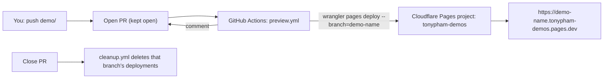

# Plan: demo previews on pages.dev (`tonypham-prototypes-deploy`)

Status: v6. Replaces the Mac + K3s + Tailscale plan, which is kept in `docs/archive/PLAN-v5.2-mac-gitops.md`. M2–M5 are built and checked offline (2026-11-17); M1 and the live checks in §7 and §8 are not done yet.

## 1. Goal

This repo stores the demos you make. Each demo lives on its own branch with a pull request (PR) that you leave open. Each open PR has a public `https://….pages.dev` link that anyone with the link can open.

> create demo branch → open PR → CI builds and deploys to Cloudflare Pages → PR comment shows the link → push again to update → close the PR to retire the demo.

Decisions confirmed with you:

| Area | Decision |
|---|---|
| Demo types | Static sites, plus small serverless functions (Pages Functions) |
| PR model | One long-lived PR per demo, never merged |
| Access | Public to anyone with the link |
| Old plan | Replaced; archived, not deleted |

Non-goals: servers or workers that run all the time, databases, private/login-gated demos, custom domains, a demo index page (`gh pr list` is the index).

## 2. How it works



One Cloudflare Pages project (`tonypham-demos`) holds every demo. Each branch deploy gets its own alias URL, `https://<branch-alias>.tonypham-demos.pages.dev`. Cloudflare turns the branch name into a hostname (slashes become dashes, and long names are cut), so the workflow reads the real URL from the deploy result and does not guess it.

## 3. Repository layout

```text
.
├── README.md
├── docs/                   # plan/, prompts/, archive/
├── demos/<name>/            # one folder per demo
│   ├── public/              # static files (or build output, see below)
│   ├── functions/           # optional Pages Functions
│   └── demo.json            # optional: {"build": "npm run build", "output": "dist"}
├── scripts/
│   ├── new-demo <name>      # scaffold folder, branch demo/<name>, draft PR
│   ├── stage <name>         # build demo into .stage/ (used by CI and local test)
│   ├── check-paths          # CI guard: the PR may change only demos/<name>/
│   └── selftest             # offline checks for the scripts
└── .github/workflows/
    ├── preview.yml          # on PR open/update for demo/*
    └── cleanup.yml          # on PR close for demo/*
```

Rule: branch `demo/<name>` may change only `demos/<name>/`. The deploy job fails if the PR touches anything else. That keeps demos from affecting each other.

## 4. Deploy flow (`preview.yml`)

1. Trigger: `pull_request` (`opened`, `synchronize`, `reopened`) when the head branch matches `^demo/[a-z][-a-z0-9]{0,22}[a-z0-9]$`.
2. Check out the PR head. Run `scripts/stage <name>`: install and build if `demo.json` has a build command, then copy the output to `.stage/public` and `demos/<name>/functions` to `.stage/functions`.
3. Run `npx wrangler pages deploy .stage/public --project-name tonypham-demos --branch demo-<name>`. Wrangler picks up `.stage/functions` when run from `.stage`.
4. Post or update one PR comment with the deployment URL.

Why Actions with Wrangler, not Cloudflare's own Git integration: the Git integration builds from the repo root with one `functions/` folder, so it cannot serve a different demo per branch. Staging a folder per demo avoids that.

Security: the workflow runs only for PRs from this repo's own branches, never forks, because it holds the Cloudflare token. Secrets are GitHub Actions secrets `CLOUDFLARE_API_TOKEN` (scope: Pages edit only) and `CLOUDFLARE_ACCOUNT_ID`. Demo functions that need secrets use `wrangler pages secret put`, which is shared by all preview deploys of the project. Do not put real secrets in demos.

## 5. Closing a demo (`cleanup.yml`)

Closing a PR does not remove a Pages deployment by itself. On `pull_request: closed`, the workflow lists deployments for `demo-<name>` through the Cloudflare API and deletes them, so the link stops working. Reopening the PR redeploys it.

## 6. Cost and limits (from memory; re-check before relying on them)

- Cloudflare Pages free plan: unlimited static requests; Functions share the Workers free quota (about 100k requests a day); a cap on files per deployment and on builds a month. Direct upload through Wrangler avoids Cloudflare's own build minutes.
- GitHub Actions on a private repo: about 2,000 free minutes a month. Spending limit stays at $0, so CI simply stops if minutes run out. You can run `wrangler pages deploy` by hand as a fallback.
- No domain, VM or Mac needed. Demos stay up when your Mac is off.

## 7. Milestones

| # | Deliverable | Done when |
|---|---|---|
| M1 | Cloudflare account, Pages project, API token, GitHub secrets | `wrangler pages deploy` of a hello page works by hand and the pages.dev URL opens |
| M2 | `scripts/stage`, `demos/hello-static`, `demos/hello-api` | `scripts/stage` output runs locally with `wrangler pages dev` |
| M3 | `preview.yml` | A test PR gets a comment with a working URL; a second push updates it |
| M4 | `cleanup.yml` | Closing the PR makes the URL return 404 |
| M5 | `scripts/new-demo`, README | A new demo goes from zero to a live link with one command |

## 8. Acceptance tests

- Static demo PR → public URL works from a device not logged in to anything.
- Function demo PR → `/api/…` route returns the expected JSON.
- Two open demo PRs → separate URLs, no cross-effect.
- PR that edits another demo's folder → deploy job fails.
- Fork PR → workflow does not run and no secret is exposed.
- Close PR → URL stops working; reopen → it works again.

## 9. Risks and open points

- **Pages vs Workers.** Cloudflare now steers new projects toward Workers static assets. pages.dev is what you asked for, so this plan uses Pages. Check at M1 that creating a Pages project is still offered. If not, the fallback is Workers, which gives `*.workers.dev`, not `pages.dev`.
- **Public means public.** Anyone with a link can open and share it. Pages URLs are not login-protected.
- **Leftover deployments.** If cleanup fails, old deployments stay live. `cleanup.yml` should be re-runnable by hand.
- **Branch alias truncation.** Long demo names are cut by Cloudflare, so keep names short (the regex above caps them at 24 characters).
